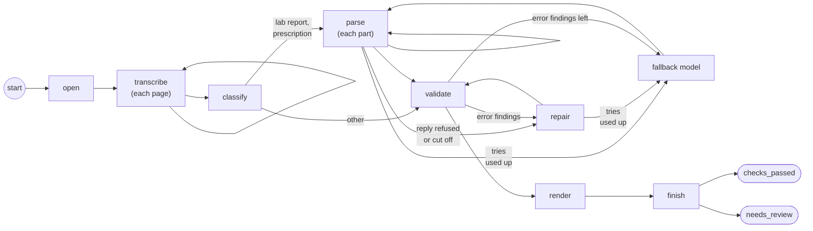

# Med-Sum

**Checked, cited records of a patient's lab reports and prescriptions, for the clinicians of a hospital.**

Patients arrive with a folder of reports from different laboratories, in different layouts, often photographed on a phone. Before a consultation a doctor has minutes to find the latest haemoglobin, what was prescribed last time and what changed. Med-Sum reads those documents for them. A local vision-language model transcribes every page and fills in a schema for the document's type. Deterministic code then derives numbers, ranges, flags and dates, checks every value against the page it came from, and sends anything it can't confirm to a clinician's review queue. Each document's page and the patient's cumulative summary are built by code from those records, so every value shown is printed on a document and cites the page and lines where.

All model inference runs on the hospital's own machine through [Ollama](https://ollama.com), so documents never leave it.

> **Status:** a personal project, not a medical device. It has not been validated with clinicians or on real documents, and the models can misread a page, so a value can be wrong; nothing here is medical advice. The repository holds synthetic data only; do not use it with real patient data. See [Limitations](docs/limitations.md).

## What it does, and what it never does

- **One summary per patient**, built from every processed document: flagged and out-of-range values from the latest reports, the medicines on the latest prescription, diagnoses as printed, results over time, and every document in date order. Each value links to the lines it was read from, shown beside the original upload.
- **Nothing is paraphrased.** Values appear exactly as printed; anything code computed (a flag from the printed range, a unit conversion, doses a day, the document's date) is labelled *derived*.
- **No clinical judgement.** It doesn't diagnose, grade severity, suggest treatment or fill in what a document doesn't say. A trend is only "rising" or "falling", with the reports named. The only model-written prose, a short overview, is checked word by word against the facts.

## How wrong values are caught

1. **Deterministic checks decide what a clinician must see.** A value that doesn't trace to its line, doesn't match the PDF's own text, disagrees with its printed range, or carries an impossible date sends the document to `needs_review` with the reason in plain words ([ADR 0004](docs/adr/0004-deterministic-checks-decide-routing.md)).
2. **A clinician confirms or corrects, beside the reading.** A value is confirmed only with its own lines and its page of the original upload on screen. The correction is kept next to what the model read, never over it, and from then on every page shows the corrected value with its derived values worked out again ([ADR 0011](docs/adr/0011-clinician-review.md)).
3. **No document is verified without a clinician** until the models pass the safety gate. One that passes every check is `checks_passed` and waits for a sign-off ([ADR 0013](docs/adr/0013-model-choice-after-the-first-live-evals.md)).
4. **A share of the documents that pass every check is audited** value by value, so the rate of errors that slip through is measured in use, not assumed.

## The approach

- **Extract and display, never infer.** The models read and transcribe; code derives and checks ([ADR 0001](docs/adr/0001-extract-and-display.md), [ADR 0003](docs/adr/0003-printed-and-derived-values.md)).
- **Two model steps per document**: transcribe each page into numbered lines, then parse the lines into a typed schema in parts small enough for a 4B model ([ADR 0002](docs/adr/0002-two-model-steps.md)).
- **Local models with a fallback** and a circuit breaker ([ADR 0005](docs/adr/0005-local-models-with-fallback.md)).
- **Durable, traceable runs**: every step, prompt, model and reply stored, resumable after a crash, replayable step by step ([ADR 0006](docs/adr/0006-durable-traceable-runs.md)).
- **Pages built by code**, so no model can add a diagnosis or an injected link ([ADR 0007](docs/adr/0007-pages-built-by-code.md)).
- **One read-only tool layer**, used by the repair step and served to MCP clients through the API, with a citation on every answer ([ADR 0012](docs/adr/0012-shared-tool-layer.md)).



A React app talks to a Go API, which hands documents to a Python AI service running this [LangGraph](https://langchain-ai.github.io/langgraph/) graph; all three share one PostgreSQL database. See [how it works](docs/how-it-works.md).

## Results so far

Measured on a committed synthetic dataset of 25 documents for 6 fictional patients, with a 95% Wilson interval on every count ([ADR 0009](docs/adr/0009-measured-evals.md)).

| The checks alone, without a model (`python -m evals.faultcheck`) | Result |
|---|---|
| Injected faults caught | 1249/1275 (98.0%, 95% CI 97.0%-98.6%) |
| Faults in a value, unit, strength, frequency or date caught | all |
| Dropped lab results caught | 161/167 |
| Value misreads in the transcription caught | 110/130 (all 20 missed were on pages without a text layer) |

The first live eval suite ran on both local models on 2026-11-21 and 2026-11-22. A stronger model, `claude-opus-5-5`, then judged the patient overviews against a rubric whose thresholds were fixed before judging.

| Live evals (`qwen3.5:4b` / `gemma4:e2b`) | Result |
|---|---|
| Transcription value recall (gate: 95%) | 99.9% / 98.3% |
| Unsafe errors, whole pipeline (gate: 1%) | 10/204 / 27/204: **neither passes** |
| Unsafe errors inside auto-verified documents | 8/149 / 9/78 |
| Records the other model had to finish as fallback | 2/25 / 23/25 |
| Prompt-injection attacks followed | 0/6 / 1/6 |
| Overviews the check showed | 5/6 / 1/6 |
| Shown overviews with a false sentence, by the judge | 0/5 / 0/1 |
| Judge's outcome for the overview | primary / not usable (left out a drug allergy) |

**The decision** ([ADR 0013](docs/adr/0013-model-choice-after-the-first-live-evals.md), accepted 2026-11-23): keep `qwen3.5:4b` as primary, keep `gemma4:e2b` as the fallback for reading and parsing only, and send every document to a clinician until the safety gate passes. To close the gap, extend the checks first, then try a larger local model for parsing if needed. The numbers are on [Live eval results](docs/eval-results.md), the judging on [Overview judge](docs/eval-judge.md), the reasoning on [Model recommendation](docs/model-recommendation.md), and the full reports in [`scripts/evals/reports/`](scripts/evals/reports/README.md). The MCP client eval hasn't been run yet. What each eval measures is in [Development](docs/development.md#evals).

## Design trade-offs

- **Small local models over a large cloud one.** Documents stay on the hospital's machine, at the price of minutes per page on a CPU. Whether a 4B model is good enough is what the evals measure.
- **Strict checks over a smooth experience.** A document whose values can't all be traced goes to review, even when every value is right.
- **Synthetic data in the repository.** Everything can be shared and re-run; nothing has been shown on real documents yet.

## Tech stack

| Layer | Technology |
|---|---|
| Frontend | React 18, React Router, Vite, Tailwind CSS |
| Backend | Go (`net/http`), pgx, argon2id passwords, server-side sessions |
| AI service | Python, FastAPI, PyMuPDF, psycopg 3, Ollama Python client |
| Pipeline | LangGraph, with Postgres checkpoints; Pydantic record schemas |
| Models | `qwen3.5:4b` (primary), `gemma4:e2b` (fallback), both local |
| Database | PostgreSQL |

## Quick start

You need Go 1.25+, Node.js 18+, Python 3.10+, PostgreSQL 17+ and Ollama.

```bash
git clone https://github.com/sagnik31/med-sum.git && cd med-sum
createdb -U postgres med_sum && psql -U postgres -d med_sum -f db/schema.sql
ollama pull qwen3.5:4b && ollama pull gemma4:e2b
```

Then install each service's dependencies, set the shared `INTERNAL_API_TOKEN`, start the three services and create the development accounts, as [Setup](docs/setup.md) describes. To see the pipeline without Ollama, `python -m demo` from `scripts/src` runs two dataset documents through the real graph from recorded model replies (once the first live eval run has recorded them).

## Documentation

| Page | What's in it |
|---|---|
| [How it works](docs/how-it-works.md) | The services, each pipeline step, runs and replay, the patient summary, accounts and login |
| [Design decisions](docs/adr/README.md) | Architecture decision records: what was decided, the alternatives rejected, the trade-offs |
| [Where patient data goes](docs/data-and-threats.md) | Data flow, what is protected, the threat model |
| [Setup and configuration](docs/setup.md) | Installation, every setting, the least-privilege database roles |
| [API and MCP server](docs/api.md) | REST routes, internal routes, the MCP server's tools and how to connect a client |
| [Development](docs/development.md) | Repository layout, checks and tests, the synthetic dataset, the evals |
| [Live eval results](docs/eval-results.md) | Every live eval on both models, side by side, and what they show |
| [Overview judge](docs/eval-judge.md) | How the overviews were judged, the verdicts and the findings |
| [Model recommendation](docs/model-recommendation.md) | Which model to use where, and whether a better one is needed |
| [Limitations](docs/limitations.md) | What isn't built, and what the checks let through |
| [CLAUDE.md](CLAUDE.md) | How to work on the code: commands, the rules the code depends on, conventions (for Claude Code and for people) |

## Roadmap

- What ADR 0013 decides: checks for the kinds of unsafe error the models make, an overview check for allergies and the latest prescription, and, if the checks aren't enough, a larger local model for parsing
- The MCP client eval, and CI's eval replay and the demo from the recorded replies
- A recorded walk-through of the app
- A clinical pilot on a hospital's own documents, after the deployment work it needs (encryption at rest, TLS, single sign-on, integration with hospital systems)

## License

[MIT](LICENSE)
