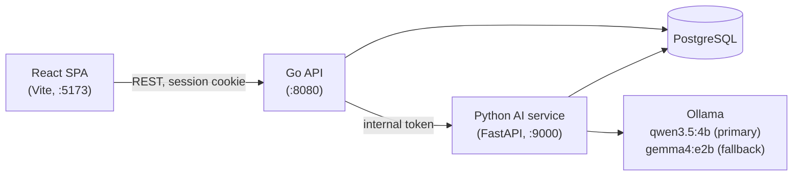

# How Med-Sum works

The services, the document pipeline step by step, the patient summary, and the security of accounts and login. Why it is built this way, with the alternatives rejected, is in the [architecture decision records](adr/README.md).

## Services

The system has three services that share one PostgreSQL database:

- **Frontend (React).** Login and password setup, staff management, patients, document upload and listing with each document's status, and viewers for the document pages and the patient summary. Every value on a document's page shows the page and lines it was read from; choosing it highlights those lines in the page's transcription beside it. Values computed by code (numbers, flags from ranges, unit conversions, dose schedules, the document date) are labelled *derived*, and a flagged value shows why. Each source reference in the patient summary (`D2 p1:6`) opens its document at those lines. A review queue lists the documents awaiting a clinician, and the review screen shows the original upload beside the values to confirm or correct, and brings each value's lines and its page of the original into view before it can be confirmed; a document whose values all passed their checks says it is not verified until a clinician signs it off, and offers the sign-off on its page; each document's "Processing details" show how its run went, step by step.
- **Backend (Go).** The public API. It handles accounts, login sessions and uploads, checks that a document belongs to the caller, serves each document's record with its citations, and forwards processing requests to the AI service.
- **AI service (Python).** Runs the document pipeline and the patient summary against local Ollama models, and builds both pages in code.

## The document pipeline

When a document is uploaded, the Go API asks the AI service to queue it. A worker in the AI service takes queued documents one at a time and runs each through the document pipeline, a [LangGraph](https://langchain-ai.github.io/langgraph/) graph. The document list and summary pages update themselves while it runs:

1. **Transcribe.** PDFs are rendered to images with PyMuPDF, and `qwen3.5:4b` transcribes each page into numbered lines, alongside the PDF's own text where it has one. A page too long for one call's 4,096-token output cap is read once more as two overlapping halves, top and bottom, and code joins them where they share an exact run of lines; if they don't, the page goes to review. A page whose reading comes back empty is never taken as read: it goes to review too, where the clinician sees the page image.
2. **Classify.** The model labels the document as a lab report, a prescription or something else, and a keyword check confirms the label. Anything else keeps its transcription and goes to review.
3. **Parse.** The model fills in the schema for that type from the transcription, one page per call. A page of more than 25 table rows is read in parts cut between rows, and a part that starts inside a table is given that table's heading and header row; the parts' replies are merged into one. The merge takes the patient's details and the dates from the first part that prints them; if a later part prints a different patient or date, the document goes to review (LC-20) rather than losing it. (One call on a 26-result report took about 5,000 output tokens, so a page of 40-odd rows would reach the 8,192-token cap.) A reply that doesn't fit the schema is sent back with what was wrong, up to twice, and only the parts that were wrong are asked again; then the fallback model gets three tries of its own.
4. **Validate.** Code builds the record (numbers, ranges, flags, dates) and checks it against the transcription and the PDF text. A value must be on its cited line as printed, so "0.5" doesn't pass for "< 0.5" nor "Reactive" for "Non-Reactive"; a lab result cites the one table row it is on; an item that appears twice in the record is caught; each printed part must be in its own field (no strength left in a medicine's name, no frequency as the dose, no flag left in a value, an allergy's text holding its substance and reaction), and no result may be read from a table's header row. Errors go back to the model for repair, like a reply that doesn't fit. By default a repair re-parses with the problems listed. With `MEDSUM_REPAIR=tools` the model may first read the document through read-only tools (numbered lines of a page, a search of the transcription, the PDF's own text, an item of the record with the lines it cites), within a budget of three model turns per repair, the one giving the fix included. A malformed tool call uses its turn, and the validators judge the fix exactly as before. Tools run only inside a repair, so a document that parses cleanly costs no more. Which repair works better is measured, not assumed (see [Evals](development.md#evals)).
5. **Render.** Code builds the document's page from the record, with no model call: every value exactly as printed, values computed by code (the document date, a flag from the printed range, a unit conversion, doses a day) marked as derived, and nothing the record doesn't hold, so no "abnormal" or severity of its own. A value that awaits review shows why, in plain words.
6. **Finish.** The record is saved with what each value traces back to. A document ends `checks_passed`, or `needs_review` when a low-confidence signal fired (a value the checks couldn't confirm, a cut-off or empty page, an item read twice, a model input that may have been cut short to fit the context window, a patient name that doesn't match the account, and others); the document page then says which values to check. Anything that can't be recovered from ends `failed` with a message, and the user can retry from the UI. No run ends `verified`: a `checks_passed` document waits in the review queue until a clinician signs it off, because the first live evals found wrong values in documents that passed every check ([ADR 0013](adr/0013-model-choice-after-the-first-live-evals.md)). It stays so until an eval run passes the safety gate.

## Runs, traces and replay

Each document's run, its steps, and the prompt and model used at each are stored in the database, with the git commit, output schemas and database structure the run used and the text of every prompt. `python -m pipeline.replay <step_id>` runs one stored transcribe, classify, parse or repair step again and shows how the reply differs (a repair is rebuilt from the problems it stored and the previous reply; a repair with tools is not replayed). On the document page, **Processing details** shows how the latest run went, and **Full trace** shows every run with each step's input, output, prompt and findings; opening it is audited. A step that can be replayed shows its replay command to copy; the app never runs one. Admins see the organisation's runs under **Pipeline runs**, with no content. **Reprocess** on the document page runs the document again from the start, for when the pipeline has changed; the new run's record replaces the last, so its reviews start again. It asks first, saying how many reviews it would discard, and is not offered while the document is being reviewed. A page whose image, model and transcription prompt are the same as in the document's earlier run is not transcribed again: the earlier run's lines are reused, and the step records which step they came from.

## The patient summary

The cumulative patient summary is a separate background job, started from the Patient summary page. Once a user has one, it is rebuilt after each of their documents finishes (once the last of a batch is done, so a batch rebuilds it once), after a review that leaves a document verified, after a sign-off, and after a delete. A request that arrives while the summary is being built isn't dropped: that build runs once more when it ends, from the records as they are then, so a correction or a deleted document always reaches the summary. It is built by code from the records of every document that has finished (`checks_passed`, `verified` or `needs_review`):

- **Order.** Documents are ordered by the date printed on them (the report date, else the sample collection date; a prescription's date), not by upload. A document with no date is listed last, marked undated, and never used for a trend or as "the latest".
- **Sections.** The patient as printed, with warnings (undated documents, values awaiting review, documents not included); values with a printed flag or outside their printed range in the latest report of each test, and recorded allergies; the medicines on the latest prescription, then earlier ones; diagnoses and impressions exactly as printed; lab results and vitals over time under their printed panels; remarks with what they are printed on; and every document in date order with its review state. Every value cites its document, page and lines.
- **Trends** are only "rising" or "falling": two or more values of a test in the same printed unit, on different dates, each higher (or lower) than the last, with "based on N reports" and the reports named. No "improving", "worsening" or confidence labels.
- **Values awaiting review** are included, marked "awaiting review" with the reason in plain words, and left out of trends.
- **A document printed for another patient** (its printed name or ID doesn't match the account) has every value marked awaiting review until a clinician confirms it: none of them joins a trend or counts as "the latest" of a test or prescription, and the patient details at the top never come from it.
- **One series is one test.** A trend never mixes two tests that share a word: "T4 (Free)" is not total T4, and a creatinine under a urine panel is not serum creatinine. A bracketed qualifier is ignored only when it names the method or a blood specimen ("TSH (Ultrasensitive)", "Ferritin (CLIA)").
- **The overview** is the only model-written part: a few sentences the model writes from the computed facts alone. The facts give each flagged value as the latest flagged value of its test, with that value's own date, since it can come from an earlier report than the latest one. Code checks the overview before it is shown. A number must be one of the facts and stand near what the facts say it is (TSH's value next to TSH, a report's date next to that report's test, a count next to "documents"), and a name with digits such as "T4" must appear whole; a count written as a word ("five") is checked as a number. Words that claim something (rising, falling, high, low, normal, flagged) must stand near what the facts say them of, and "no" or "none" only next to a kind of fact the facts list none of, so "TSH is rising" fails when TSH falls and "no allergies" fails when one is recorded. A word from printed text (a diagnosis, an allergy) must stand beside the rest of that text. Every other word must be a test, medicine or unit name of the facts, a fixed word of the facts' own lines, or one of a fixed list of ordinary words, so a test, medicine or diagnosis that isn't in the facts can't get through. The overview must also name what a clinician can't do without: every recorded allergy to a named substance (by its substance; "NKDA" or "None known" is not one) and every medicine on the latest prescription (by its name, without the strength). A reply that fails is sent back once with what failed. If the second reply fails too, or the primary model doesn't answer, the summary is still saved without the overview and says why. Only the primary model writes the overview: the fallback never does ([ADR 0013](adr/0013-model-choice-after-the-first-live-evals.md)).

## Design notes

The reasons behind these, with the alternatives rejected, are in ADRs [0005](adr/0005-local-models-with-fallback.md) (fallback and breaker), [0006](adr/0006-durable-traceable-runs.md) (leases and checkpoints) and [0007](adr/0007-pages-built-by-code.md) (pages built by code).

- **The AI service is not exposed to the browser.** Only the Go API calls it, after checking that the document belongs to the user, and every call carries a shared secret.
- **Recovery from crashed workers.** A job is claimed with a lease of 5 minutes, which a heartbeat renews every minute while the document runs. When a worker dies, its lease runs out and another worker takes the job over, carrying on from the graph's last checkpoint (kept in Postgres) instead of starting again. A job claimed three times without finishing is set aside, and every write a worker makes checks, in the same transaction, that it still holds the claim: the job's own rows and its run's steps, record and end. A worker whose lease ran out without a renewal stops at the next step and leaves the run and its checkpoints to the worker that took it over. The patient summary keeps a simpler lock: a summary with no progress for 30 minutes can be taken over by a new request, and the run that lost it can no longer write its result or failure.
- **Untrusted model output is contained.** A document can carry text aimed at the model, so what the models read off it is treated as untrusted. No page is model-written HTML: the document page and the patient summary are built by code, and every printed value is escaped, so text that looks like HTML is shown as text. The one piece of model-written prose, the summary's overview, is checked word by word and escaped too. The UI shows each page in a sandboxed iframe with scripts disabled and a content security policy that blocks every remote load, so the HTML cannot send data to another server.
- **Bounded work.** Uploads must be PDF, JPG or PNG files whose content matches the extension, are capped at 20 MB and 20 PDF pages, and are stored under random file names. Model output is capped per page and per summary so a looping model cannot run forever, and a model call that sends nothing for 10 minutes is abandoned.
- **Fallback model and circuit breaker.** Both models read images and text. If `qwen3.5:4b` returns an error, hits the output cap or its reply stream ends before Ollama's final chunk, the same request goes to `gemma4:e2b`. That holds for reading and parsing, whose output the checks and routing judge; the summary's overview has no fallback. If both fail, the job is marked `failed`, so cut-off output is never saved as a result. A model whose server errors (a 4xx answer is the request's fault and doesn't count) or times out three times in a row is skipped for 15 minutes, so requests go straight to the other model; after that one call tries it again. A document whose run switched a model off or back on carries an operational signal saying so, stored with the run; it doesn't send the document to review. With both skipped, a job fails at once with "No model available". A reply the pipeline can't use (off its schema, or failing the checks) is counted per model for diagnosis but doesn't trip the breaker. `GET /health` shows each model's state.

## Accounts and login

The decisions behind these are in [ADR 0010](adr/0010-staff-access-and-security.md).

The app is for hospital staff; patients have no accounts. A patient is a record that the clinicians of one organisation share.

- **Accounts are created, never signed up for.** `medsumctl create-admin` and `create-user` create an account and print a one-time setup link (valid for 72 hours) that the person opens to choose their own password; `medsumctl reset-link` issues a reset link (24 hours). The token is in the link's URL fragment, which browsers don't send to servers, and only its SHA-256 is stored.
- **Passwords** are hashed with argon2id (OWASP parameters). They need at least 12 characters, and common ones are refused. Five wrong passwords in a row lock the account for 15 minutes. Every failed login gets the same answer, and an unknown email takes as long to refuse as a wrong password, so the login form can't be used to find out which accounts exist.
- **Sessions** are rows in the database, not tokens the browser can read. The browser holds a random value in an `HttpOnly`, `SameSite=Strict` cookie; the database holds only its hash. A session ends after 30 minutes without a request or 12 hours after login. Logging out, changing the password or disabling the account ends sessions at once.
- **Patients:** a clinician finds a patient by name or MRN (the hospital's patient ID) or adds one, with a date of birth or, when that isn't known, an age, and uploads documents to that patient's record. The pipeline checks the name, ID and date of birth printed on each document against the record. Another organisation's patients and documents answer 404, and the organisation is checked in the SQL of every query, not in the handlers. Only the clinician who uploaded a document can delete it; deleting hides it everywhere and rebuilds the patient summary, but keeps its rows and file, so what was uploaded stays accountable.
- **Roles:** a *clinician* works with patients, documents and summaries; an *admin* manages staff accounts and sees no clinical data. Someone who needs both holds both roles. The API checks a permission on every route (`backend/internal/authz`), and the frontend shows only the pages the account may use.
- **Staff management:** an admin invites staff from the Staff page, which shows a setup link to pass on, and can change roles, disable or enable an account, or issue a password reset link. Disabling an account or changing its roles logs it out everywhere. Admins can't disable themselves or drop their own admin role, and an organisation always keeps at least one active admin.
- **Audit log:** every login (and failed login), lockout, logout, password and staff change, and every read or change of patient data writes one row to `audit_events`: who, what, which record and patient, the outcome, the address and browser. It holds ids, never clinical content (no names, values or file names; details are counts, field names and reasons). A change writes its row in its own transaction, so both commit or neither does; a read writes its row before the data is sent, and is refused (500) when it can't. A trigger refuses UPDATE and DELETE on the table. Admins read their organisation's log on the Audit log page, filtered by staff account, patient and dates.
- **Your sessions:** the Account page lists where you are logged in and can log out any of those sessions, or all but the current one.
- **CSRF:** besides `SameSite=Strict`, every request that changes something must carry an `X-Requested-With` header, which another site can't add without passing a CORS check that only `ALLOWED_ORIGINS` pass.
- **Login attempts per address:** each address gets 10 attempts a minute on the routes that check a password or a link (`POST /auth/login`, `/auth/password`, `/auth/setup`, `/auth/setup/info`); more answer 429 with `Retry-After`, and the refusal is audited. This slows guessing across accounts, which the per-account lockout doesn't. The count is kept in memory, per API process. Behind the Vite proxy the address is the browser's, which the proxy names in `X-Forwarded-For` and the API believes only from `TRUSTED_PROXIES`; otherwise every request would come from the proxy and share one limit.
- **Security headers** on every API response: `Content-Security-Policy: default-src 'none'; frame-ancestors 'none'`, `X-Content-Type-Options: nosniff`, `X-Frame-Options: DENY`, `Referrer-Policy: no-referrer`, `Cache-Control: no-store` (responses carry patient data), and HSTS when cookies are `Secure`. The Vite server sends the framing, sniffing and referrer headers for the app's own pages.
- **Idle warning:** every response to a logged-in request says how many seconds the session has left (`X-Session-Expires-In`); two minutes before the end the app asks whether to stay signed in. The page's own polls while a document or a summary is processed send `X-Medsum-Background: 1` and don't count as activity; they slow from every 5 s to once a minute, and carry on through a network or server error.
- **Secrets:** each service reads its secrets from an untracked `.env.local` (copied from the committed `.env.example`), never from a committed script. Both services refuse to start without `INTERNAL_API_TOKEN` of at least 32 characters; the AI service listens on `127.0.0.1` only, as only the Go API calls it.
